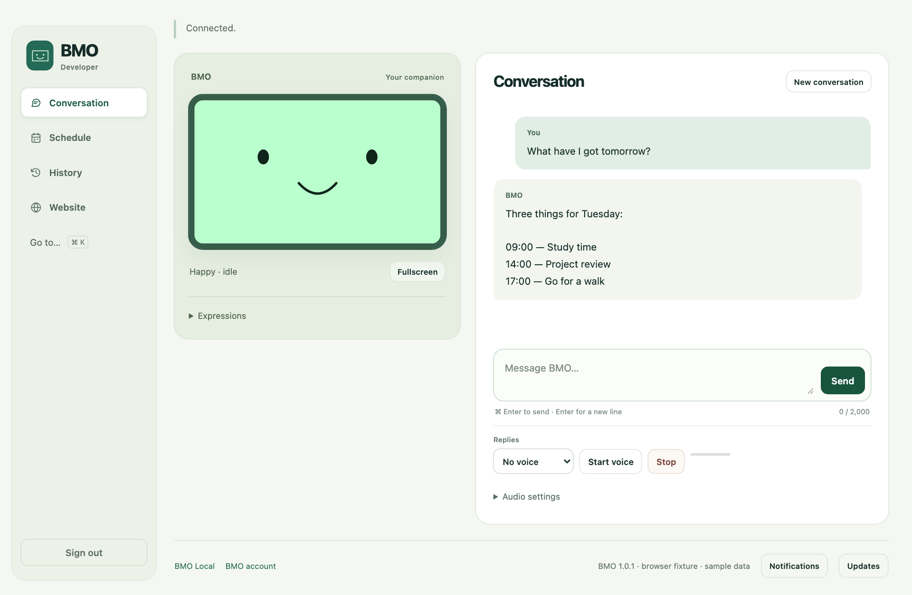
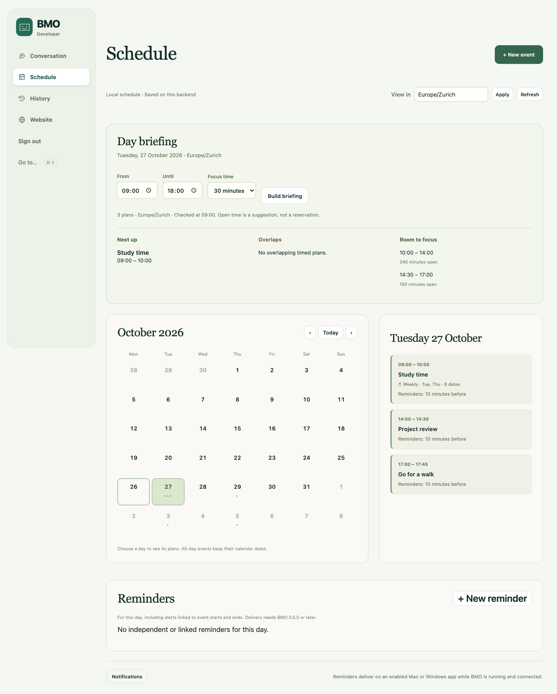

# BMO

BMO is a personal desktop and web companion for talking through plans, keeping a calendar, and saving information for later. It is a personal project for someone who wants to manage their own day by voice or keyboard and still be able to inspect and edit the records behind a reply.

## What works

- **Conversation.** Type or speak, choose a reply voice, and interrupt playback with Stop. The face changes expression with the conversation, and its mouth follows the amplitude of the audio being played.
- **Calendar and briefings.** Edit plans directly or through conversation. The shared calendar supports recurring events, exceptions for individual dates, and standalone or event-linked reminders. The day briefing lists plans, overlaps, and open time without booking it.
- **Memory and history.** Edit saved notes and procedures in the Brain library. Conversation history is separate from both the editable library and the context used to resume a chat.
- **Local and account modes.** The local desktop mode keeps records on the device and supports export and import. It uses installed OS voices for speech output and needs a supported provider key for model-backed chat. Signed-in accounts use the shared service with account-scoped records and provider settings.
- **Personal integrations.** The Developer edition can read Gmail and work with synced WhatsApp conversations. Sending a WhatsApp message requires confirmation of the exact recipient and text.

*The desktop schedule with fictional events. The calendar and briefing use the scheduling code from the app.*

## Architecture

The web interface uses JavaScript, HTML, and CSS without a frontend framework. The macOS and Windows clients reuse conversation, face, and calendar modules inside a Tauri 2 shell. Rust handles OS credential storage, installed voices, native notifications, and the updater. A separate Node.js service handles sign-in, streamed conversations, model providers, and account operations. PostgreSQL stores shared records and SQLite stores service state such as device sessions and independent reminders. The backend can use Whisper for local transcription.

Three implementation choices are worth a closer look.

- **Stop is scoped to one turn.** The client stops capture and queued playback, then cancels the matching server turn. Sequence and turn IDs keep late responses from interfering with a newer turn. Reconnecting reads current state without resubmitting the old message.
- **Recurrence preserves local time.** Timed series retain their IANA time zone so a weekly appointment stays at the same local hour across daylight-saving changes. A change to one occurrence is stored separately from the series. The briefing calculates availability from the same calendar.
- **Actions have explicit boundaries.** The conversation engine loads procedures and their associated tools as needed. The messaging flow stores an expiring draft and claims it once before dispatch. An uncertain outcome is surfaced without silently sending again.

## Project status

BMO is in active development. The web interface and bring-your-own-key signup are live. 

Hosted model access and public installers are pending. The physical enclosure and native iPhone app are planned.

The full source is private during development and available for review on request.

## Credits

BMO is an independent fan project inspired by *Adventure Time*. The face renderer draws on [be-more-agent](https://github.com/brenpoly/be-more-agent). The WhatsApp integration builds on [whatsapp-mcp](https://github.com/lharries/whatsapp-mcp).
